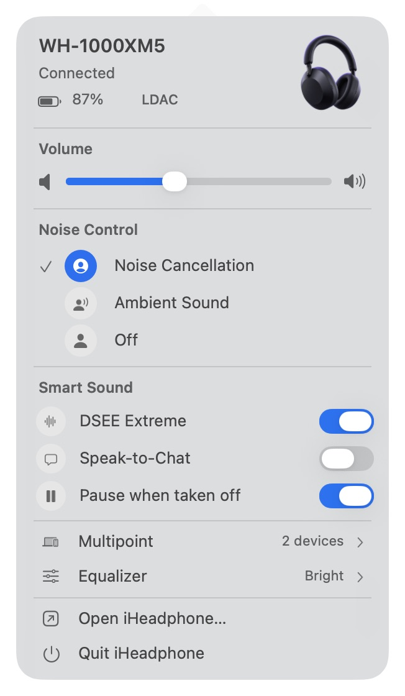
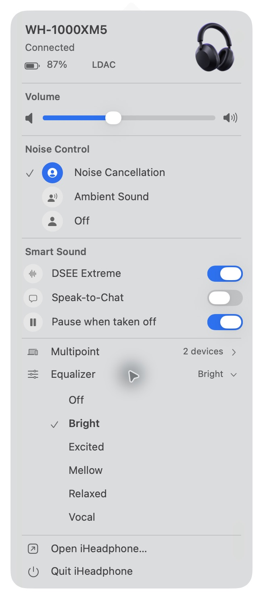
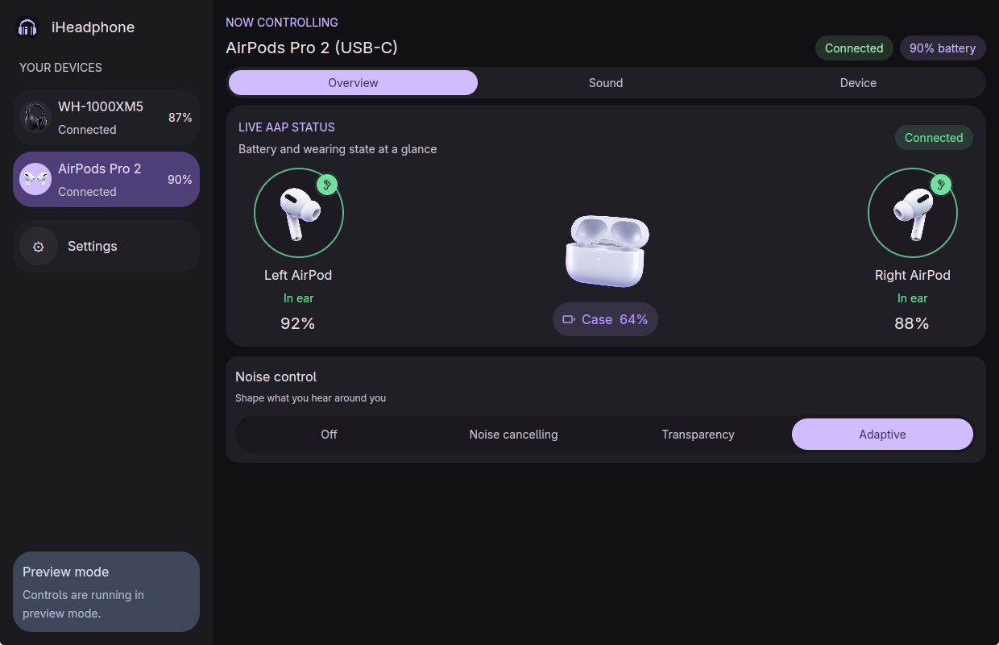
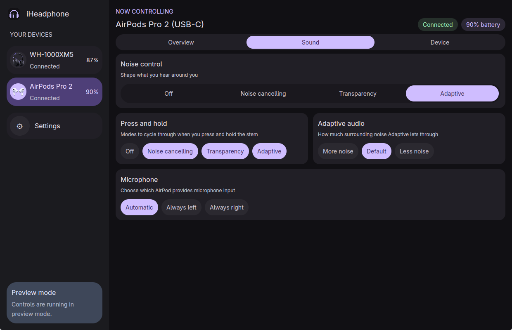
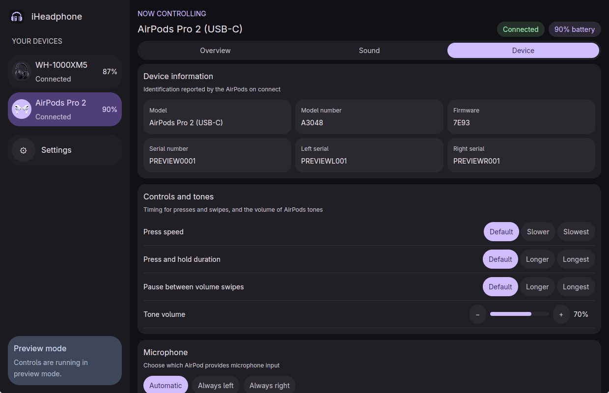
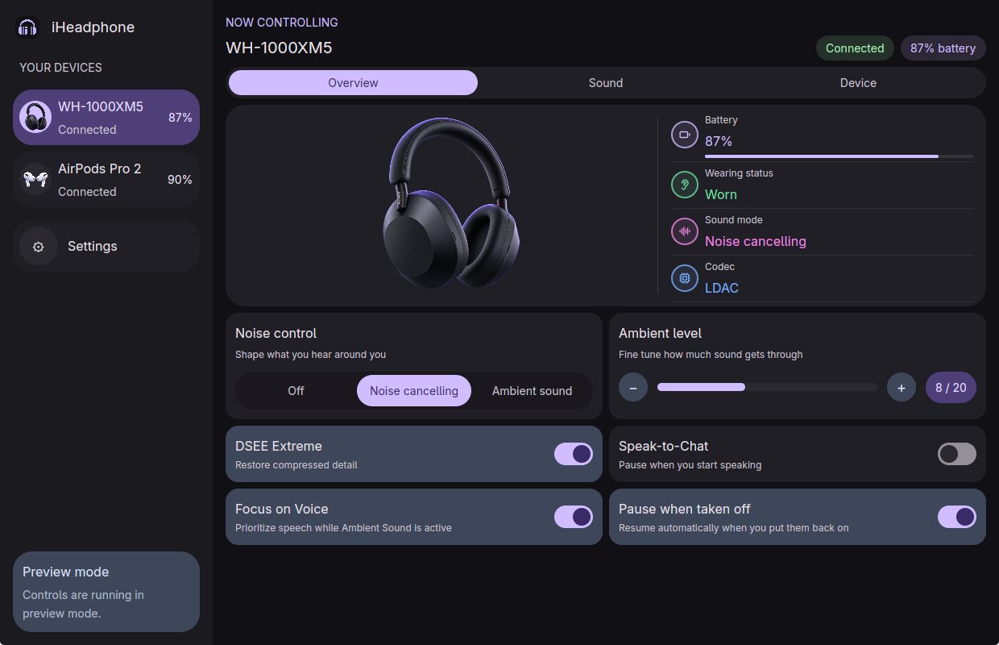
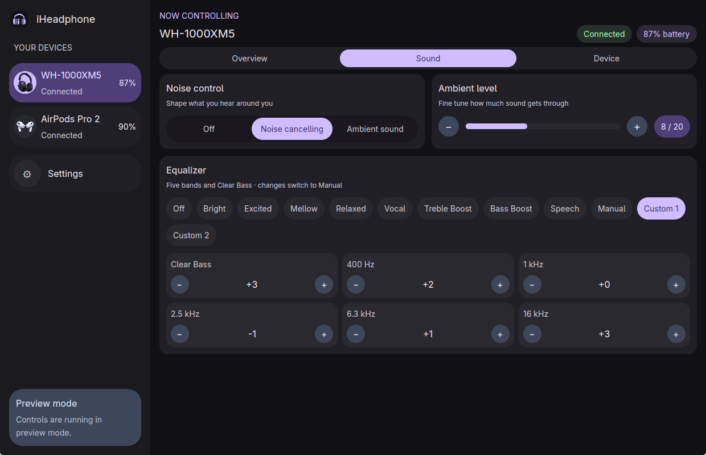

# iHeadphone

A native Linux and macOS desktop controller for AirPods and Sony headphones.

Control Sony headphones directly from the macOS menu bar, including battery, volume, noise control,
smart-sound switches, equalizer presets, and multipoint audio sources. Equalizer and device choices
expand inline below their row.

<table>
  <tr>
    <th>macOS menu-bar controls</th>
    <th>Inline equalizer presets</th>
  </tr>
  <tr>
    <td valign="top"></td>
    <td valign="top"></td>
  </tr>
</table>



<table>
  <tr>
    <td></td>
    <td></td>
  </tr>
  <tr>
    <td></td>
    <td></td>
  </tr>
</table>

Screenshots show preview mode (`IHEADPHONE_DEMO=1`) with sample values.

The desktop app uses GPUI Kit. Sony WH-1000XM5 discovery and controls use a local Bluetooth RFCOMM
transport and a reviewed, I/O-free Sony V2 protocol crate. Initial wire layouts and captured test
messages were adapted from the MIT-licensed [`sound-connect`](https://github.com/aecca/sound-connect)
project; its license notice is preserved beside the protocol source.

On Linux, AirPods use a separate local Apple Accessory Protocol (AAP) implementation over the
classic Bluetooth L2CAP channel at PSM `0x1001`. Protocol layouts were reviewed against the
MIT/Apache-2.0 [`podctl`](https://github.com/Rockykln/podctl) implementation; iHeadphone does not
depend on or execute podctl.

## Current scope

- Linux: AirPods and Sony WH-1000XM5 control.
- macOS: Sony WH-1000XM5 control plus native menu-bar controls for battery, volume, noise control,
  smart sound, equalizer presets, and multipoint audio sources. AirPods remain managed by macOS.

On macOS, iHeadphone starts in the menu bar without opening the main window and stays available
after that window is closed. Click the headphones icon (and battery percentage while connected) to see the current
device status and change settings without opening the full controller. Click Equalizer or Multipoint
to expand choices in place; choosing an option collapses the list. Clicking outside closes the popover.
Choose Open iHeadphone at the bottom to open the main window, or Quit to exit.

## Run with real AirPods hardware on Linux

Pair and connect the AirPods in the system Bluetooth settings, then run the normal desktop app.
iHeadphone identifies connected Apple headphones through BlueZ and opens AAP alongside the Sony
backend, so both device types may remain paired.

The AirPods backend supports left, right, and case battery and charging state, in-ear state,
ANC/Transparency/Adaptive/Off, the press-and-hold mode cycle, Adaptive Audio strength, Conversation
Awareness, Automatic Ear Detection, one-AirPod noise cancellation, microphone selection, press
speed, press-and-hold duration, tone volume, volume swipe and its interval, and Personalized
Volume. It also reads the model, model number, firmware, and serial numbers the AirPods report on
connect.

AirPods only detect speech for Conversation Awareness; on iOS the phone lowers the volume. On
Linux, iHeadphone does that itself: while Conversation Awareness is on and media is playing, it
lowers the default Bluetooth sink by 15 dB through `pactl` when you start speaking and eases it back
as the AirPods report the conversation ending. A volume you change by hand in the meantime is left
alone.

The model is identified from the BlueZ modalias product ID and confirmed by the model number in
the device information packet. Controls the model lacks are hidden; for example, AirPods Max get a
single-device layout without ear detection or Adaptive. Unrecognised models keep every control.
AirPods do not report the current press-and-hold cycle, so it shows as unset until you choose one.

Set `IHEADPHONE_TRACE_AIRPODS=1` to log incoming AAP packets while diagnosing a particular model.

## Run with real Sony hardware

```sh
cargo run -p iheadphone-desktop
```

Pair and connect the WH-1000XM5 in the operating system's Bluetooth settings. The app then opens
Sony's control channel and keeps reconnecting when the headphones become available.

The XM5 hardware backend currently supports battery and charging state, ANC/Ambient/Off, ambient
level and Focus on Voice, DSEE Extreme, Speak-to-Chat and its options, five-band EQ with Clear Bass
and presets, firmware and codec readback, wear-sensor pause, automatic power off, the NC/Ambient
button cycle, multipoint device readback and source switching, and software power off.

On Linux, iHeadphone registers its own AVRCP player with BlueZ while the app is running, so headset
media buttons reach MPRIS players such as browsers and desktop music apps. Headsets choose Play or
Pause from playback state they track themselves, and AirPods keep sending Play once that state is
stale; every Play, Pause, or Play/Pause press therefore toggles whatever is actually playing. Next and
Previous go to the playing player. Do not run BlueZ's `mpris-proxy` alongside the app: its players
register ahead of iHeadphone's and bring the stale state back.

The XM5 does not always emit an AVRCP pause when Speak-to-Chat activates. iHeadphone also listens
for Sony's private active/inactive conversation notifications and pauses the currently playing
MPRIS players with `playerctl`, resuming only the players it paused when the conversation ends.

For a reversible real-hardware write-path check:

```sh
cargo run -p iheadphone-transport --example xm5_smoke
```

## Run the UI with simulated devices

```sh
IHEADPHONE_DEMO=1 cargo run -p iheadphone-desktop
```

## macOS application image

Create a local application bundle and DMG from a release executable:

```sh
cargo build --release --locked -p iheadphone-desktop
scripts/package-macos.sh target/release/iheadphone 0.1.0
```

The local command packages the architecture of the executable it receives and writes an image such
as `dist/iHeadphone-0.1.0-arm64.dmg`. The release workflow builds both Apple Silicon and Intel
executables, combines them into `iHeadphone-0.1.0-universal.dmg`, and attaches it to the GitHub
Release when a tag such as `v0.1.0` is pushed. It can also be run manually with an optional tag.
Leave the tag empty to use `v` plus the version in `[workspace.package]` in `Cargo.toml`.
Missing tags are created at the selected ref's commit; existing tags are reused and their commit
is built. To release a new version, update the Cargo version or enter a new tag explicitly.

Release images use an ad-hoc signature until a Developer ID certificate is configured. macOS may
therefore ask the user to confirm the first launch. Set `IHEADPHONE_CODESIGN_IDENTITY` when running
the packaging script with an installed Developer ID certificate.

## Language

Open **Settings** from the bottom of the sidebar and choose **English** or **简体中文**. The whole
interface switches immediately and remembers the selection across restarts. On Linux the preference
is stored under `$XDG_CONFIG_HOME/iheadphone` (or `~/.config/iheadphone`); on macOS it is stored in
`~/Library/Application Support/iHeadphone`.

For UI development on macOS, set `IHEADPHONE_OPEN_MAIN_WINDOW=1` to show the main window on launch.
Set `IHEADPHONE_OPEN_SETTINGS=1` to open directly on the settings page, or
`IHEADPHONE_OPEN_DEVICE=sony|airpods` and `IHEADPHONE_OPEN_PAGE=overview|sound|device` to open a
particular device page.
`scripts/screenshots.sh` regenerates the Linux README screenshots from preview mode inside isolated
virtual KWin sessions, so nothing else on your desktop is captured.

To preview the actual macOS popover in an isolated app-owned window for screenshots:

```sh
IHEADPHONE_DEMO=1 IHEADPHONE_OPEN_POPOVER=1 IHEADPHONE_MENU_PREVIEW_WINDOW=1 cargo run -p iheadphone-desktop
```

Capture the popover itself, then expand Equalizer to capture its inline choices. The screenshot
preview uses the same controls as the status item; it does not connect to headphones.

## Verify

```sh
cargo fmt --check
cargo test --workspace
cargo check --workspace
```

### Wayland desktop icon

Wayland compositors resolve the window icon through the application's desktop ID rather than the
X11 window-icon field. Install the development desktop entry and hicolor icon for the current user:

```bash
sh packaging/linux/install-desktop-integration.sh
```

The application ID and desktop filename are both `io.github.iheadphone.iheadphone`.
